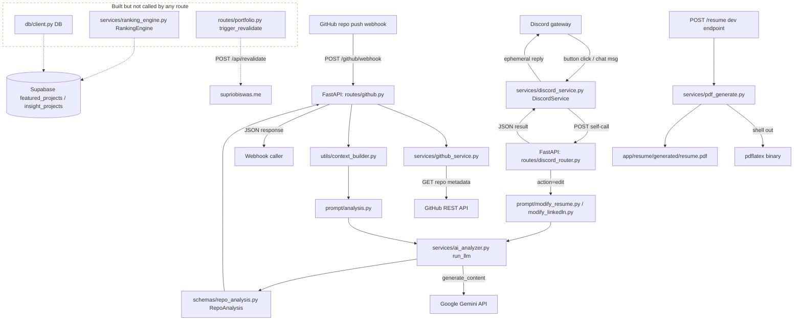
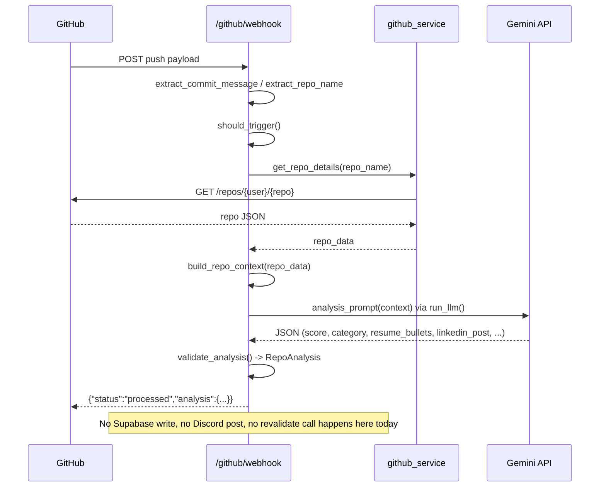

# automation-system — Technical Reference

Generated by read-only repository analysis on 2026-08-23. Repo root: `d:\Development\Automation\automation-system`. Branch `main`, HEAD `be9f682`.

This is a **small, early-stage FastAPI backend** (no frontend in this repo). It is a "GitHub → AI analysis → Discord approval → portfolio update" automation pipeline for a personal developer portfolio (`supriobiswas.me`). Several pieces exist in code but are **not yet wired together** — this is called out explicitly throughout, since it's the single most important thing for a continuing developer/AI to know.

---

## 1. Repository Structure

```text
automation-system/
├── .env                              # Secrets (gitignored). Loaded via python-dotenv.
├── .gitignore                        # Ignores .env, .venv/, __pycache__/, node_modules/, *.db
├── requirements.txt                  # Pinned Python deps (pip freeze style, one package per line)
│
└── app/
    ├── __init__.py                   # Empty. Makes `app` a package.
    ├── main.py                       # FastAPI app entrypoint. Creates `app`, registers routers, health check.
    │
    ├── core/
    │   ├── config.py                 # Loads .env via dotenv; exposes all env vars as module-level constants.
    │   └── supabase.py               # Creates the shared Supabase client using SUPABASE_URL/SUPABASE_KEY.
    │
    ├── db/
    │   └── client.py                 # `DB` class: static CRUD helpers over Supabase tables
    │                                 # (featured_projects, insight_projects). NOT CALLED ANYWHERE (dead code today).
    │
    ├── routes/
    │   ├── router_config.py          # Wires which routers are mounted on the FastAPI app, and their prefixes.
    │   ├── github.py                 # POST /github/webhook — the main pipeline entrypoint (GitHub webhook receiver).
    │   ├── discord_router.py         # POST /discord/approval — receives approve/reject/edit actions from the Discord bot.
    │   ├── test.py                   # POST /resume — dev/test endpoint that renders+compiles the LaTeX résumé with dummy data.
    │   └── portfolio.py              # NOT a router (no APIRouter/endpoints). Just holds `trigger_revalidate()`.
    │                                 # NOT imported by router_config.py — file name is misleading, it registers no routes.
    │
    ├── services/
    │   ├── ai_analyzer.py            # `run_llm()` — calls Gemini, parses JSON, optionally validates against RepoAnalysis schema.
    │   ├── github_service.py         # `get_repo_details()` — GitHub REST API call (repo metadata).
    │   ├── pdf_generate.py           # LaTeX templating (Jinja-free string replace) + pdflatex subprocess compile pipeline.
    │   ├── ranking_engine.py         # `RankingEngine` — top-N ranking/replacement logic for featured/insight projects in Supabase.
    │   │                             # NOT CALLED ANYWHERE (dead code today; no route invokes it).
    │   ├── discord_service.py        # `DiscordService` — discord.py Client wrapper: sends draft messages w/ buttons,
    │   │                             #   handles button interactions and chat-based edit flow, calls back into the FastAPI backend.
    │   └── discord_test.py           # Standalone manual-run script: boots a DiscordService with hardcoded dummy
    │                                 #   analysis/resume data and starts the bot. Effectively a demo/dev harness, not
    │                                 #   invoked by the web app or the webhook pipeline.
    │
    ├── schemas/
    │   ├── repo_analysis.py          # Pydantic `RepoAnalysis` model — validates Gemini's JSON output for /github/webhook.
    │   └── schemas.py                # EMPTY FILE. Placeholder, unused.
    │
    ├── prompt/
    │   ├── analysis.py                # `analysis_prompt(context)` — main GitHub-repo → portfolio-value analysis prompt for Gemini.
    │   ├── modify_resume.py           # `resume_modify_prompt(context)` — prompt used by the Discord "edit" flow for résumé bullets.
    │   └── modify_linkedln.py         # `linkedin_modify_prompt(context)` — prompt used by the Discord "edit" flow for LinkedIn posts.
    │                                  # (Filename typo "linkedln" is real, not a transcription error — see §19.)
    │
    ├── utils/
    │   ├── trigger.py                 # `should_trigger(commit_message)` — gate on whether a commit should run the pipeline.
    │   ├── extract_commit.py          # `extract_commit_message(payload)` — pulls `head_commit.message` from GitHub payload.
    │   ├── extract_repoName.py        # `extract_repo_name(payload)` — pulls `repository.name` from GitHub payload.
    │   ├── context_builder.py         # `build_repo_context(repo_data)` — trims raw GitHub repo JSON to a compact dict for the prompt.
    │   ├── update_stage.py            # `update_stage(...)` — mutates/logs a shared pipeline-status dict used by /github/webhook.
    │   ├── output_parser.py           # `parse_ai_response(raw_text)` — `json.loads` wrapper with a descriptive error on failure.
    │   ├── output_validator.py        # `validate_analysis(data)` — validates a dict against `RepoAnalysis`.
    │   └── approval_view.py           # `ApprovalView(discord.ui.View)` — Approve/Edit/Reject Discord buttons (persistent view).
    │
    └── resume/
        ├── resume.tex                 # LaTeX résumé template with `{{FEATURED_PROJECTS}}` / `{{INSIGHT_PROJECTS}}` placeholders.
        └── generated/
            └── resume.pdf              # Last compiled output of the résumé pipeline (build artifact, checked into repo).
```

No frontend code, no database migration files, no Dockerfile, no CI config, and no test suite exist in this repository as of this commit.

### File dependency notes (imports)

- `app/main.py` → `app/routes/router_config.py` → `github.py`, `test.py`, `discord_router.py` (routers only; **`portfolio.py` is never imported**).
- `app/routes/github.py` → `services/github_service.py`, `services/ai_analyzer.py`, `utils/trigger.py`, `utils/extract_commit.py`, `utils/extract_repoName.py`, `utils/update_stage.py`, `utils/context_builder.py`, `prompt/analysis.py`.
- `app/routes/discord_router.py` → `services/ai_analyzer.py`, `prompt/modify_resume.py`, `prompt/modify_linkedln.py`.
- `app/routes/test.py` → `services/pdf_generate.py`, reads `app/resume/resume.tex` directly off disk.
- `app/services/ai_analyzer.py` → `google.genai` SDK, `core/config.py` (GEMINI_API_KEY), `utils/output_parser.py`, `utils/output_validator.py` → `schemas/repo_analysis.py`.
- `app/services/github_service.py` → `core/config.py` (GITHUB_TOKEN, GITHUB_USERNAME), `requests`.
- `app/services/discord_service.py` → `discord.py` library; calls back into this same FastAPI app over HTTP (`POST http://localhost:8000/discord/approval`).
- `app/services/discord_test.py` → `services/discord_service.py`, `utils/approval_view.py`; loads its **own** `.env` via `load_dotenv()` (does not go through `core/config.py`).
- `app/db/client.py` and `app/services/ranking_engine.py` → `core/supabase.py` → `core/config.py` (SUPABASE_URL/KEY). Neither is imported by any route.
- `app/routes/portfolio.py` → `core/config.py` (REVALIDATE_SECRET), `requests`. Not imported anywhere.

---

## 2. Tech Stack

### Frontend
**None in this repository.** There is no `frontend/`, no HTML/JS/CSS templates beyond the LaTeX résumé, and no static file serving in `main.py`. The portfolio site itself (`supriobiswas.me`) is an external Next.js-style deployment inferred only from `REVALIDATE_SECRET` and the URL `https://supriobiswas.me/api/revalidate` in `app/routes/portfolio.py` — its source is not part of this repo.

### Backend
- **Framework:** FastAPI (`fastapi==0.136.3`), served by Uvicorn (`uvicorn==0.48.0`).
- **API architecture:** Plain REST-style JSON endpoints via `APIRouter`s, no versioning, no OpenAPI customization beyond FastAPI defaults.
- **Authentication:** **None implemented.** No auth middleware, no API keys checked on incoming requests, no JWT/session handling anywhere in `app/`. `/github/webhook` and `/discord/approval` are open endpoints (see §19 security notes). `REVALIDATE_SECRET` is an *outbound* shared secret sent to the external portfolio site, not inbound auth for this API.
- **Validation:** Pydantic v2 (`pydantic==2.13.4`) — used for the Discord approval request body (`DiscordApprovalRequest` in `discord_router.py`) and for validating Gemini's structured output (`RepoAnalysis` in `schemas/repo_analysis.py`).
- **Database access:** `supabase-py` client (`supabase==2.31.0`) via `app/core/supabase.py`, wrapped by `app/db/client.py` (`DB`) and `app/services/ranking_engine.py` (`RankingEngine`) — both currently unused by any route.
- **Background jobs / queues:** None (no Celery/RQ/BullMQ-equivalent, no cron).
- **WebSockets/SSE:** None on the FastAPI side. The **Discord bot** (`discord.py==2.x`, per `discord` import) maintains its own gateway WebSocket connection to Discord, but that's a separate process/library, not part of the FastAPI app.

### Database
- **Type:** Supabase (hosted Postgres) accessed purely through the Supabase REST client — no direct SQL, no ORM (no SQLAlchemy/Prisma/etc. in `requirements.txt`).
- **Schema:** **Not present in this repository.** No migration files, no SQL DDL, no Supabase CLI config. Table structure must be inferred from usage (see §6).
- **Tables referenced in code:** `featured_projects`, `insight_projects`. No other tables are referenced anywhere in `app/`.

### Infrastructure
- **Hosting:** Unclear from code — no Dockerfile, Procfile, `render.yaml`, `fly.toml`, or platform-specific config found. `discord_service.py`'s hardcoded callback URL `http://localhost:8000/discord/approval` implies local/single-host development, not a distributed deployment.
- **Docker:** None.
- **Redis:** None.
- **Storage:** None beyond the local filesystem (LaTeX/PDF written to `app/resume/generated/`).
- **External services:** GitHub REST API, Google Gemini API, Supabase, Discord API, and the external portfolio site's revalidate endpoint (`supriobiswas.me`). Detailed in §9.
- **CI/CD:** None found (no `.github/workflows`, no other CI config).
- **Monitoring:** None; only `print()`-based console logging throughout (see `update_stage.py`, `ai_analyzer.py`, `discord_service.py`).
- **LaTeX toolchain:** `pdflatex` is shelled out to via `subprocess.run` in `services/pdf_generate.py` — requires a TeX distribution (e.g., MiKTeX/TeX Live) installed on the host, external to this Python project.

---

## 3. Dependency Map

Actual, as-wired-today flow (not aspirational):

```text
GitHub (webhook)                         Discord (slash-button interactions)
   ↓ POST                                    ↓ discord.py Client (gateway WS)
FastAPI: POST /github/webhook             DiscordService (services/discord_service.py)
   ↓                                          ↓ POST http://localhost:8000/discord/approval
   ├─ utils/extract_commit.py             FastAPI: POST /discord/approval (routes/discord_router.py)
   ├─ utils/extract_repoName.py              ↓ (action == "edit")
   ├─ utils/trigger.py                    prompt/modify_resume.py or prompt/modify_linkedln.py
   ├─ services/github_service.py             ↓
   │     → GitHub REST API                services/ai_analyzer.py (run_llm)
   ├─ utils/context_builder.py               ↓
   ├─ prompt/analysis.py                  Google Gemini API
   ↓                                          ↓
services/ai_analyzer.py (run_llm)         utils/output_parser.py (json.loads)
   ↓                                          ↓
Google Gemini API                         JSON response
   ↓                                          ↓
utils/output_parser.py (json.loads)       HTTP response back to Discord bot
   ↓                                          ↓ interaction.followup.send(...)
utils/output_validator.py                 Discord channel (ephemeral message)
   → schemas/repo_analysis.py (RepoAnalysis)
   ↓
JSON response returned to GitHub's webhook caller
   (── pipeline STOPS here — no DB write, no Discord post, no revalidate call ──)
```

Separately, disconnected today:

```text
DiscordService.send_draft()  ── only invoked manually by services/discord_test.py (dummy data)
   → posts résumé PDF + LinkedIn text to Discord channels with Approve/Edit/Reject buttons

services/ranking_engine.py (RankingEngine)  ── never imported by any route
   → would read/write Supabase tables featured_projects / insight_projects

app/db/client.py (DB)  ── never imported by any route
   → generic CRUD over the same two Supabase tables

routes/portfolio.py (trigger_revalidate)  ── never imported by any route
   → would POST to https://supriobiswas.me/api/revalidate

routes/test.py: POST /resume  ── dev-only endpoint
   → services/pdf_generate.py → app/resume/resume.tex → pdflatex subprocess → app/resume/generated/resume.pdf
```

**Bottom line:** the *only* fully working end-to-end flow is `POST /github/webhook` → GitHub API → Gemini → validated JSON → HTTP response. Everything past "get an AI analysis of a repo" (persisting to Supabase, ranking, posting to Discord, regenerating the résumé PDF from real data, revalidating the live site) is built as isolated, working pieces that have not yet been connected into that webhook flow.

---

## 4. Complete API Map

### `POST /github/webhook`
**Defined in:** [app/routes/github.py](app/routes/github.py)
**Registered with prefix** `/github` in [app/routes/router_config.py](app/routes/router_config.py) → full path `/github/webhook`.
**Auth:** None. No signature verification of the GitHub webhook secret (see §12, §19).
**Request body:** Raw GitHub webhook JSON payload (expected shape: a push-event payload with `head_commit.message` and `repository.name`). No Pydantic model — parsed via `await request.json()`.
**Validation:** None on the way in; the *output* of the AI step is validated via `RepoAnalysis` (Pydantic) inside `ai_analyzer.run_llm(..., validate=True)`.
**Flow:**
1. Parse JSON body → `pipeline_status["webhook"]`.
2. `extract_commit.extract_commit_message(payload)` — **note:** despite the name, this returns `True` (bool) if the commit message is literally the string `"publish:true"`, else `""`. It does not return the actual commit message text (see §19 bug).
3. `extract_repoName.extract_repo_name(payload)` — reads `payload["repository"]["name"]`.
4. If commit message is falsy → `{"status": "ignored", "reason": "empty commit message"}`.
5. If repo name is falsy → `{"status": "error", "reason": "repo not found"}`.
6. `utils/trigger.should_trigger(commit_message)` — currently just `bool(commit_message)`; combined with step 2's semantics, this is effectively a second redundant truthiness check (see §19).
7. `services/github_service.get_repo_details(repo_name)` → GitHub REST API `GET /repos/{GITHUB_USERNAME}/{repo_name}` with `Authorization: token {GITHUB_TOKEN}`.
8. `utils/context_builder.build_repo_context(repo_data)` — trims to `name`, `description`, `language`, `homepage`, `topics` (drops empty values).
9. README fetch stage — explicitly marked `"Skipped (not implemented yet)"`.
10. `prompt/analysis.analysis_prompt(context)` builds the LLM prompt; `services/ai_analyzer.run_llm(prompt, validate=True)` calls Gemini (`gemini-2.5-flash`, forced JSON MIME type), parses, and validates against `RepoAnalysis`.
11. Save stage — explicitly marked `"Skipped (not implemented yet)"` (no Supabase write happens here).
12. Returns `{"status": "processed", "repo": repo_name, "analysis": analysis}`.
13. `finally` block always prints a `PIPELINE SUMMARY` of `pipeline_status` to console.
**Database operations:** None.
**Response structure:** Varies by branch — `{"status": "ignored"|"error"|"processed", ...}` (no fixed schema/response_model declared on the route).
**Frontend callers:** None (no frontend in repo). **Real caller:** a GitHub repository webhook configured externally (not present in this repo) pointing at this endpoint, presumably on push events.
**External services involved:** GitHub REST API, Google Gemini API.

### `POST /discord/approval`
**Defined in:** [app/routes/discord_router.py](app/routes/discord_router.py)
**Registered** with no prefix in `router_config.py` → full path `/discord/approval`.
**Auth:** None.
**Request body:** Pydantic model `DiscordApprovalRequest`:
```python
draft_id: str
action: str                 # "approve" | "reject" | "edit" | anything else
draft_type: str | None       # "resume" | "linkedin" (required when action == "edit")
content: str | None
feedback: str | None
```
**Validation:** FastAPI/Pydantic validates the request body shape automatically; `draft_type`/prompt routing is validated manually in the handler.
**Flow:**
- `action in ["approve", "reject"]` → returns `{"status": "success", "draft_id", "action"}` **without doing anything else** — no DB update, no state change, no notification (see §19: approve/reject are effectively no-ops today).
- `action == "edit"` → requires `draft_type`; builds `context = {"content": payload.content, "instruction": payload.feedback}`; routes to `prompt/modify_resume.resume_modify_prompt` or `prompt/modify_linkedln.linkedin_modify_prompt`; calls `services/ai_analyzer.run_llm(prompt, validate=False)` (no schema validation for edits); returns the raw AI JSON (`resume_bullets` or `linkedin_post`) or an error.
- Anything else → `{"status": "ignored", "message": "unknown action"}`.
**Database operations:** None.
**Response structure:** `{"status", "draft_id", "action", "result"?, "error"?}`.
**Frontend callers:** None. **Real caller:** `DiscordService.send_to_backend()` in [app/services/discord_service.py](app/services/discord_service.py), triggered by button clicks (`approve_btn`/`reject_btn`) or a chat message following an `edit_btn` click, via a **hardcoded** `http://localhost:8000/discord/approval` URL.
**External services involved:** Google Gemini API (edit flow only).

### `POST /resume`
**Defined in:** [app/routes/test.py](app/routes/test.py)
**Registered** with no prefix → full path `/resume`.
**Auth:** None.
**Request body:** None (no request parameters at all).
**Validation:** None.
**Flow:** Loads `app/resume/resume.tex` from disk → calls `services/pdf_generate.generate_resume_pipeline(template, dummy_featured(), dummy_insights())` with **hardcoded dummy project data** defined in the same file → renders LaTeX (string `.replace()` on `{{FEATURED_PROJECTS}}`/`{{INSIGHT_PROJECTS}}` placeholders) → shells out to `pdflatex` → cleans up aux files → **overwrites and then deletes** `app/resume/resume.tex`, leaving only `app/resume/generated/resume.pdf` (see §19: this endpoint destroys its own source template file on every call — genuinely dangerous if run against the only copy of the `.tex` template without a backup, though the current template is tracked in git so it's recoverable via `git checkout`).
**Database operations:** None.
**Response structure:** `{"pdf_path": str}`.
**Frontend callers:** None. This is a manual/dev-triggered test endpoint (name literally `test_resume`).
**External services involved:** None (local `pdflatex` binary only).

### `GET /`
**Defined in:** [app/main.py](app/main.py)
**Auth:** None. **Flow:** Trivial health check. **Response:** `{"status": "running"}`.

---

## 5. Authentication Flow

**There is no authentication system in this codebase.** No login, no signup, no session store, no JWT issuance/verification, no OAuth, no Supabase Auth usage (only the Supabase **data** client is used, not `supabase.auth`), no API-key gate on any FastAPI route.

The closest things to "auth" are outbound, not inbound:
- `REVALIDATE_SECRET` (env var) — sent as an `x-secret` header **from** this backend **to** the external portfolio site's revalidate endpoint, in `app/routes/portfolio.py`'s `trigger_revalidate()`. This authenticates *this backend* to the *portfolio site*, not the other way around, and this function is currently unused (dead code).
- `GITHUB_TOKEN` — a personal access token used as a bearer credential when this backend calls the GitHub REST API (`app/services/github_service.py`). Outbound only.
- `DISCORD_BOT_TOKEN` — used by `discord.Client.run(token)` to authenticate the bot process to Discord's gateway (`services/discord_service.py`, `services/discord_test.py`). This secures the *bot connection*, not the FastAPI HTTP API.

**Practical implication:** `/github/webhook` and `/discord/approval` are open, unauthenticated HTTP endpoints. Anyone who can reach the host can POST to either. There is no GitHub webhook signature verification (`X-Hub-Signature-256`) anywhere in the code. See §19 for the security callout.

---

## 6. Database Architecture

No migration files or SQL schema exist in the repository. The schema below is **reconstructed from code usage only** — actual column types/constraints in Supabase are unclear from code and should be verified directly against the Supabase project.

### Table: `featured_projects`
Referenced in: `app/db/client.py` (`DB.get_featured_projects`, `insert_featured_project`, `update_featured_project`, `upsert_featured_project`), `app/services/ranking_engine.py` (`RankingEngine.get_featured`, `_handle_featured`).
Columns implied by usage:
- `id` — primary key, used in `.eq("id", project_id)` / `.eq("id", lowest["id"])` deletes.
- `slug` — used as the upsert conflict key in `DB.upsert_featured_project` (default `key="slug"`).
- `score` — numeric; used for `.order("score", desc=True)` and top-4 ranking comparisons in `RankingEngine`.
- `title` — read for logging (`lowest.get("title")`).
- Remaining columns are whatever the Gemini analysis JSON contains (see `RepoAnalysis`/the `analysis_prompt` output contract): `title, slug, score, description, live, category, summary, stack, reason, github_repo, resume_bullets, linkedin_post` — these are the fields `RankingEngine.process_project(ai_result)` would insert verbatim if it were called, but **no code currently calls `process_project`**, so this is the intended-but-unwired shape, not a confirmed live schema.

### Table: `insight_projects`
Referenced in: `app/db/client.py` (`get_insight_projects`, `insert_insight_project`, `update_insight_project`, `upsert_insight_project` — default upsert key `"title"`, inconsistent with `featured_projects`' `"slug"` key, see §19), `app/services/ranking_engine.py` (`get_insights`, `_handle_insight`).
Columns implied by usage: same pattern — `id`, `score`, `title`, plus whatever else is in the AI-generated project dict.

**Relationships:** No foreign keys are used or implied anywhere in the code — the two tables are independent, selected into by `category` (`"featured"` vs `"insight"`) from the same AI analysis shape.

**Indexes/constraints:** Unclear from code. `score` is queried with `.order(..., desc=True)` frequently enough that an index would help, but nothing in-repo confirms one exists.

**Migrations:** None present. Table creation must have happened directly in the Supabase dashboard/SQL editor, outside this repo.

**Seed data:** None in-repo. `dummy_featured()`/`dummy_insights()` in `app/routes/test.py` are hardcoded Python fixtures for the résumé-PDF test endpoint only — they are never written to Supabase.

**Modules that touch these tables:**
```text
app/db/client.py (DB)                  → featured_projects, insight_projects   [defined, UNUSED]
app/services/ranking_engine.py         → featured_projects, insight_projects   [defined, UNUSED]
```
No route currently reads or writes either table.

---

## 7. Major Feature Data Flows

### Feature: GitHub push → AI portfolio-value analysis (the one complete flow)
```text
Developer pushes a commit with message "publish:true" to a GitHub repo
        ↓
GitHub sends a webhook POST to /github/webhook  (external config, not in this repo)
        ↓
app/routes/github.py: github_webhook()
        ↓
utils/extract_commit.py + utils/extract_repoName.py  (parse payload)
        ↓
utils/trigger.py: should_trigger()  (gate)
        ↓
services/github_service.py: get_repo_details()  → GitHub REST API
        ↓
utils/context_builder.py: build_repo_context()  (trim fields)
        ↓
prompt/analysis.py: analysis_prompt(context)
        ↓
services/ai_analyzer.py: run_llm()  → Google Gemini (gemini-2.5-flash, JSON mode)
        ↓
utils/output_parser.py: parse_ai_response()  (json.loads)
        ↓
utils/output_validator.py → schemas/repo_analysis.py: RepoAnalysis  (Pydantic validation)
        ↓
HTTP 200 JSON response back to the webhook caller (GitHub)
        ↓
(nothing persisted — Supabase, Discord, and the live site are never touched by this flow today)
```

### Feature: Discord approval / edit workflow (manually demoed, not connected to the flow above)
```text
services/discord_test.py run manually
        ↓
DiscordService.send_draft() with hardcoded dummy analysis/resume data
        ↓
Discord: résumé PDF + LinkedIn text posted to two channels with an ApprovalView (Approve/Edit/Reject buttons)
        ↓
User clicks a button → discord.py on_interaction handler in services/discord_service.py
        ↓
  ├─ approve_btn / reject_btn → DiscordService.send_to_backend({"action":..., "draft_id":...})
  │        ↓
  │     POST http://localhost:8000/discord/approval
  │        ↓
  │     routes/discord_router.py → returns {"status":"success",...} — NO further action taken
  │
  └─ edit_btn → stores an edit_sessions[user_id] entry, asks user to type an instruction in chat
           ↓
        on_message handler captures the next message from that user
           ↓
        DiscordService.send_to_backend({"action":"edit","draft_id","draft_type","content","feedback"})
           ↓
        POST http://localhost:8000/discord/approval
           ↓
        routes/discord_router.py → prompt/modify_resume.py or prompt/modify_linkedln.py
           ↓
        services/ai_analyzer.py: run_llm(..., validate=False) → Gemini
           ↓
        JSON {"resume_bullets":[...]} or {"linkedin_post": "..."} returned to the bot
           ↓
        interaction.followup.send(formatted result)  → shown ephemerally to the Discord user
```
Note: the edited content is **shown back to the user in Discord but never saved anywhere** — `DiscordService.drafts[draft_id]` in memory is not updated with the edit result, and there is no Supabase write. A second edit on the same draft would still operate on the original content.

### Feature: Résumé PDF generation (dev/test endpoint)
```text
POST /resume (no body)
        ↓
routes/test.py: load_tex() reads app/resume/resume.tex
        ↓
routes/test.py: dummy_featured() / dummy_insights()  (hardcoded fixtures)
        ↓
services/pdf_generate.py: generate_resume_pipeline()
        ↓
  render_latex()  → string .replace() of {{FEATURED_PROJECTS}} / {{INSIGHT_PROJECTS}} placeholders
        ↓
  writes app/resume/generated/resume.tex, then compile_pdf() shells out to `pdflatex`
        ↓
  cleans up .aux/.log/.out/.toc, deletes the generated .tex, keeps resume.pdf
        ↓
returns {"pdf_path": "app/resume/generated/resume.pdf"}
```

---

## 8. AI / LLM Architecture

- **Provider:** Google (Gemini), via the `google-genai` SDK (`google-genai==2.8.0`), not LangChain/LlamaIndex — no agent framework, no tool-calling, no RAG, no vector DB, no embeddings anywhere in this repo.
- **Model:** `gemini-2.5-flash`, hardcoded in `app/services/ai_analyzer.py`.
- **Client construction:** `genai.Client(api_key=GEMINI_API_KEY)` — module-level singleton in `ai_analyzer.py`, created at import time.
- **Single entrypoint:** `async def run_llm(prompt: str, validate: bool = False)` — despite being declared `async`, the actual Gemini call (`client.models.generate_content(...)`) is a **synchronous, blocking call** (no `await`, no `asyncio.to_thread`), so it will block the FastAPI event loop for the duration of the Gemini request (see §19).
- **Prompts** (all pure Python f-strings, no template engine, no chaining):
  - `prompt/analysis.py: analysis_prompt(context)` — the main repo-evaluation prompt. Instructs Gemini to score a repo 0–100, classify it into `featured`/`insight`/`ignore`, and generate ATS-style résumé bullets plus a LinkedIn post, returned as **strict JSON** matching the `RepoAnalysis`-adjacent contract shown in §4.
  - `prompt/modify_resume.py: resume_modify_prompt(context)` — takes `{content, instruction}` and asks Gemini to revise résumé bullets per a user instruction, returning `{"resume_bullets": [str]}`.
  - `prompt/modify_linkedln.py: linkedin_modify_prompt(context)` — same pattern for `{"linkedin_post": str}`.
- **Response handling:**
  - Gemini is called with `config={"response_mime_type": "application/json"}`, forcing JSON output.
  - `utils/output_parser.py: parse_ai_response(raw_text)` — `json.loads`, raising a descriptive exception (including the raw text) on failure.
  - `utils/output_validator.py: validate_analysis(data)` — only used when `run_llm(..., validate=True)` (the GitHub-webhook path); validates against `schemas/repo_analysis.py: RepoAnalysis`. The Discord edit flow calls `run_llm(..., validate=False)`, so its JSON shape is trusted without schema enforcement.
- **No streaming** — `generate_content` is called for a full response, not `generate_content_stream`; no SSE/WebSocket relay to any client.
- **No memory/state across calls** — every `run_llm` call is stateless; conversation/session history is not tracked (the Discord edit flow re-sends the *current* content + a new instruction each time, not a chat history).
- **No routing/agents/tools** — one model, one call shape, three distinct prompt-builders selected by simple `if/elif` in the calling route, not by a router model.

### AI request lifecycle (github webhook path)
```text
repo context dict
   ↓
prompt/analysis.py builds prompt string
   ↓
services/ai_analyzer.py: run_llm(prompt, validate=True)
   ↓
google-genai SDK → Gemini API (gemini-2.5-flash, JSON mime type)
   ↓
raw JSON text response
   ↓
utils/output_parser.py: json.loads()
   ↓
utils/output_validator.py: RepoAnalysis.model_validate()
   ↓
dict returned to routes/github.py, embedded directly in the HTTP response
```

---

## 9. External Services

| Service | Why used | Configured in | Called from | Data sent | Data received | Failure handling |
|---|---|---|---|---|---|---|
| **GitHub REST API** | Fetch repo metadata (description, language, homepage, topics) after a push webhook | `GITHUB_TOKEN`, `GITHUB_USERNAME` in `.env` → `core/config.py` | `services/github_service.py: get_repo_details()` | `GET /repos/{user}/{repo}` with bearer token header | Full repo JSON | On non-200, returns `{"error": ..., "details": res.text}`; caller (`routes/github.py`) checks `"error" in repo_data` and returns an error response. No retry. |
| **Google Gemini API** | Repo analysis + résumé/LinkedIn copy generation | `GEMINI_API_KEY` in `.env` → `core/config.py` | `services/ai_analyzer.py: run_llm()` | Full prompt text (repo context or edit instruction + existing content) | JSON text response | Wrapped in try/except; returns `{"success": False, "error": "gemini_failed", "message": str(e), "data": None}`. No retry/backoff. |
| **Supabase (Postgres)** | Intended persistence for featured/insight portfolio projects | `SUPABASE_URL`, `SUPABASE_KEY` in `.env` → `core/config.py` → `core/supabase.py` | `db/client.py`, `services/ranking_engine.py` (both currently unreferenced by any route) | Table rows (insert/update/upsert/delete) | Query results | No explicit error handling wrapper — raw `supabase-py` exceptions would propagate if these modules were invoked. |
| **Discord API** | Bot posts drafts with approve/edit/reject buttons, relays edits | `DISCORD_BOT_TOKEN`/`DISCORD_TOKEN`, `DISCORD_RESUME_CHANNEL_ID`, `DISCORD_LINKEDIN_CHANNEL_ID` in `.env` | `services/discord_service.py`, `services/discord_test.py` | Messages, files (résumé PDF), interactive views | Button interactions, chat messages | `try/except` around interaction/message handlers with `traceback.format_exc()` printed; failures are swallowed (bot keeps running but silently drops the action). |
| **This backend's own HTTP API (self-call)** | Discord bot process relays button/chat actions back to FastAPI | Hardcoded URL, not env-configurable: `http://localhost:8000/discord/approval` | `services/discord_service.py: send_to_backend()` | `{action, draft_id, draft_type?, content?, feedback?}` | `{status, draft_id, action, result?, error?}` | `try/except` around the `requests.post` call; on failure, prints traceback and returns `None` (caller doesn't handle `None` specially, see §19). |
| **External portfolio site revalidate endpoint** | Trigger ISR/rebuild of `supriobiswas.me` after portfolio data changes | `REVALIDATE_SECRET` in `.env` | `routes/portfolio.py: trigger_revalidate()` (**currently unused/uncalled**) | `POST https://supriobiswas.me/api/revalidate` with `x-secret` header, no body | Not inspected — return value discarded | No error handling at all; response isn't checked or returned. |
| **LaTeX toolchain (`pdflatex`)** | Compile the résumé `.tex` into a PDF | N/A (external binary on `PATH`) | `services/pdf_generate.py: compile_pdf()` | `.tex` file on disk | `.pdf` + aux files on disk | `subprocess.run(..., check=False)` — a failed compile is silently ignored; the endpoint still returns a `pdf_path` even if `pdflatex` failed or is missing. |

---

## 10. Environment Variables

All loaded via `python-dotenv`'s `load_dotenv()`. Two separate load sites exist: `app/core/config.py` (used by the FastAPI app) and `app/services/discord_test.py` (used by the standalone bot script) — they read overlapping but not identical variable names (see §19).

```text
GITHUB_TOKEN
  Used by: app/core/config.py → app/services/github_service.py
  Purpose: Bearer token for GitHub REST API calls to fetch repo metadata.

GITHUB_USERNAME
  Used by: app/core/config.py → app/services/github_service.py
  Purpose: GitHub username/org whose repo is being fetched (URL path segment).

GEMINI_API_KEY
  Used by: app/core/config.py → app/services/ai_analyzer.py
  Purpose: Authenticates the google-genai client to the Gemini API.

REVALIDATE_SECRET
  Used by: app/core/config.py → app/routes/portfolio.py (currently unused/uncalled function)
  Purpose: Shared secret sent as `x-secret` header to the external portfolio site's revalidate endpoint.

SUPABASE_URL
  Used by: app/core/config.py → app/core/supabase.py
  Purpose: Supabase project URL for the REST/data client.

SUPABASE_KEY
  Used by: app/core/config.py → app/core/supabase.py
  Purpose: Supabase API key (service role or anon — unclear from code) for the data client.

DISCORD_TOKEN
  Used by: app/core/config.py (as DISCORD_BOT_TOKEN)
  Purpose: Intended Discord bot token. NOTE: no such key exists in .env (which has DISCORD_BOT_TOKEN instead) —
  os.getenv("DISCORD_TOKEN") in config.py currently resolves to None. This constant is not imported/used anywhere,
  so the bug is latent, not currently crashing anything.

DISCORD_BOT_TOKEN
  Used by: app/services/discord_test.py (its own load_dotenv(), not via core/config.py)
  Purpose: Actual working Discord bot token env var name, used when running the bot standalone.

DISCORD_RESUME_CHANNEL_ID
  Used by: app/core/config.py AND app/services/discord_test.py (each parses it independently via int(os.getenv(...)))
  Purpose: Discord channel ID where résumé drafts are posted.

DISCORD_LINKEDIN_CHANNEL_ID
  Used by: app/core/config.py (as DISCORD_LINKEDLN_CHANNEL_ID, note the typo) AND app/services/discord_test.py
  Purpose: Discord channel ID where LinkedIn drafts are posted.
```

`config.py` calls `int(os.getenv("DISCORD_RESUME_CHANNEL_ID"))` and `int(os.getenv("DISCORD_LINKEDIN_CHANNEL_ID"))` unconditionally at **module import time** — if either is unset, this raises `TypeError: int() argument must be a string... not 'NoneType'` and crashes any process that imports `app.core.config` (which includes the main FastAPI app, since `routes/github.py` → `services/github_service.py` → `core.config` is on the import chain from `main.py`). See §19.

---

## 11. Background Processing

**None.** No queue, no worker process, no cron/scheduler, no BullMQ/Celery/RQ equivalent. The Discord bot (`discord_service.py`/`discord_test.py`) is a long-running process with its own event loop (discord.py's gateway client), but it is not a job queue — it's a separate always-on process that happens to call back into the FastAPI app synchronously per interaction.

---

## 12. Webhooks / Events

### Inbound: GitHub webhook → `POST /github/webhook`
```text
GitHub repository (push event, external config not in this repo)
        ↓
POST /github/webhook  (app/routes/github.py)
        ↓
No signature verification (no X-Hub-Signature-256 check anywhere in the code)
        ↓
Parsed for head_commit.message and repository.name only
        ↓
Processed synchronously inline in the request handler (see §4/§7)
```
**Signature verification: not implemented.** Any client that can POST valid-looking JSON to this endpoint can trigger a Gemini call and get an analysis back (cost/abuse exposure — see §19).

### Inbound: Discord interactions → self-callback → `POST /discord/approval`
This isn't a webhook in the HTTP sense (Discord talks to the bot over its gateway WebSocket, not via a webhook URL); the "event" path is: Discord gateway event → `discord_service.py` handler → outbound `requests.post` to this app's own `/discord/approval` route. Covered fully in §7.

There is no Stripe/payment webhook, no other third-party webhook receiver in this repo.

---

## 13. Frontend Architecture

**Not applicable — there is no frontend in this repository.** The "UI" surface that exists is entirely the Discord bot's message/button interface (`app/utils/approval_view.py`'s `ApprovalView`, driven by `app/services/discord_service.py`), plus the generated LaTeX/PDF résumé file. If a web frontend for this system exists, it lives in a separate repository (likely the `supriobiswas.me` Next.js portfolio site referenced by `REVALIDATE_SECRET`), not here.

---

## 14. Important Functions and Classes

| Symbol | Location | Responsibility | Called by | Calls |
|---|---|---|---|---|
| `github_webhook()` | [app/routes/github.py](app/routes/github.py) | Orchestrates the entire GitHub→AI-analysis pipeline for one webhook request | GitHub (external) | `extract_commit_message`, `extract_repo_name`, `should_trigger`, `get_repo_details`, `build_repo_context`, `run_llm`, `update_stage` |
| `run_llm(prompt, validate)` | [app/services/ai_analyzer.py](app/services/ai_analyzer.py) | Single chokepoint for all Gemini calls in the system | `github.py`, `discord_router.py` | `google.genai` SDK, `parse_ai_response`, `validate_analysis` |
| `get_repo_details(repo_name)` | [app/services/github_service.py](app/services/github_service.py) | Fetches repo metadata from GitHub REST API | `routes/github.py` | GitHub REST API via `requests` |
| `DiscordService` | [app/services/discord_service.py](app/services/discord_service.py) | Wraps a discord.py `Client`; owns draft/edit-session in-memory state, message sending, interaction/message event handlers, and the callback into this backend | `discord_test.py` (constructs it); Discord gateway (drives its event handlers) | `discord.py` library, `requests.post` to `/discord/approval` |
| `ApprovalView` | [app/utils/approval_view.py](app/utils/approval_view.py) | Persistent Discord UI view with Approve/Edit/Reject buttons; button callbacks are intentionally empty (`pass`) — all real handling happens in `DiscordService.on_interaction` via `custom_id` | `DiscordService` (constructed per draft, and once at startup with `draft_id="base"` for persistence) | discord.py `ui` framework |
| `RankingEngine.process_project(ai_result)` | [app/services/ranking_engine.py](app/services/ranking_engine.py) | Would decide whether an AI-analyzed project gets inserted into `featured_projects`/`insight_projects`, replacing the weakest existing entry if the new one scores higher | **Nothing currently** (dead code) | `core/supabase.py` client |
| `DB` (static class) | [app/db/client.py](app/db/client.py) | Generic CRUD wrapper over the two Supabase tables | **Nothing currently** (dead code) | `core/supabase.py` client |
| `generate_resume_pipeline(template, featured, insights)` | [app/services/pdf_generate.py](app/services/pdf_generate.py) | Full résumé build: template render → write .tex → `pdflatex` compile → cleanup | `routes/test.py` | `render_latex`, `compile_pdf` |
| `RepoAnalysis` (Pydantic model) | [app/schemas/repo_analysis.py](app/schemas/repo_analysis.py) | Defines/enforces the shape of Gemini's structured repo-analysis output | `utils/output_validator.py` | — |
| `update_stage(...)` | [app/utils/update_stage.py](app/utils/update_stage.py) | Mutates a shared per-request `pipeline_status` dict and logs progress to console | `routes/github.py` (repeatedly, at each pipeline stage) | — |

---

## 15. Mermaid Architecture Diagram





---

## 16. Request Lifecycle

Concrete trace for `POST /github/webhook` (the only complete flow):

```text
GitHub sends webhook POST
  → Uvicorn ASGI server (app/main.py: app = FastAPI())
  → FastAPI routing: matched to app.routes.github.router (mounted at /github by router_config.py)
  → app/routes/github.py: github_webhook(request: Request)
      → await request.json()                          # no auth/signature middleware exists at any layer
      → utils/extract_commit.extract_commit_message(payload)
      → utils/extract_repoName.extract_repo_name(payload)
      → utils/trigger.should_trigger(commit_message)
      → services/github_service.get_repo_details(repo_name)   # blocking `requests.get` call inside an async handler (see §19)
      → utils/context_builder.build_repo_context(repo_data)
      → prompt/analysis.analysis_prompt(context)
      → services/ai_analyzer.run_llm(prompt, validate=True)    # blocking genai call inside an async function (see §19)
          → utils/output_parser.parse_ai_response(text)
          → utils/output_validator.validate_analysis(data) → schemas/repo_analysis.RepoAnalysis
      → utils/update_stage.update_stage(...) called at each stage transition
  → return dict  → FastAPI serializes to JSON  → HTTP 200 response to GitHub
  → finally block prints the full pipeline_status summary to server console
```

There is no frontend, so "frontend state"/"UI" steps don't apply; the "client" here is GitHub's webhook delivery system (or, for manual testing, any HTTP client such as curl/Postman).

---

## 17. Project Architecture Summary

**What this application does:** It's a personal automation backend that, on a GitHub push tagged `publish:true`, fetches the repo's metadata and asks Gemini to score/classify it and draft résumé bullets + a LinkedIn post for the developer's portfolio. It also contains (separately, not yet connected) a Discord-based human-in-the-loop approval bot for reviewing/editing those AI drafts, a LaTeX résumé PDF generator, and Supabase-backed storage/ranking logic for featured vs. insight portfolio projects.

**How it is structured:** A single FastAPI app (`app/main.py`) mounting three routers (`github`, `test`/résumé, `discord_router`) via `app/routes/router_config.py`. Business logic lives in `app/services/*`, prompt text in `app/prompt/*`, small pure helpers in `app/utils/*`, Pydantic schemas in `app/schemas/*`, and Supabase access in `app/core/supabase.py` + `app/db/client.py`. A standalone script (`app/services/discord_test.py`) runs the Discord bot as its own process.

**How data moves through it:** GitHub payload → extraction helpers → GitHub API enrichment → prompt construction → Gemini → JSON parse/validate → HTTP response. That's the only flow that currently persists nowhere and returns data directly to the caller. The Discord flow is a second, independent loop: Discord interaction → self-HTTP-call to this same backend → (for edits) Gemini → HTTP response back to the bot → ephemeral Discord message. Neither flow currently writes to Supabase or triggers the portfolio site rebuild.

**How authentication works:** It doesn't, for inbound HTTP. Outbound calls to GitHub, Gemini, Supabase, and Discord are each authenticated with their own service-specific token/key from `.env`.

**How the database works:** Supabase Postgres via the `supabase-py` REST client, no ORM, no migrations in-repo, two tables (`featured_projects`, `insight_projects`) accessed through `DB` (generic CRUD) and `RankingEngine` (top-N ranking) — both currently dead code, not called by any route.

**How AI works:** One provider (Google Gemini, `gemini-2.5-flash`), one call function (`run_llm`), three prompt templates (analysis, résumé-edit, LinkedIn-edit) selected by simple conditional branching in the route handlers. No agent framework, no RAG, no streaming, no multi-turn memory.

**How frontend and backend communicate:** There is no frontend in this repo to communicate with. The nearest thing to a "client" experience is the Discord bot UI and the JSON responses returned to whatever calls `/github/webhook`, `/discord/approval`, or `/resume` directly.

**How it is deployed:** Unclear from code — no Dockerfile, no CI/CD, no hosting config in the repository. The hardcoded `http://localhost:8000` callback URL in `discord_service.py` strongly suggests the current stage of development is local-only.

---

## 18. Development Guide

**Add a new API endpoint:** Create a new file under `app/routes/`, define an `APIRouter()`, add your `@router.<method>(...)` handlers, then register it in `app/routes/router_config.py`'s `register_routers(app)` (mirror the existing `app.include_router(...)` calls; note `portfolio.py` shows what happens if you forget this step — it silently never gets mounted).

**Add a new frontend page:** Not applicable in this repo — no frontend exists here.

**Add a new database field:** No migrations exist; add the column directly in the Supabase dashboard/SQL editor (outside this repo), then extend the relevant dict-building code (`RankingEngine`, `DB`, or wherever the field is produced/consumed — likely the `analysis_prompt`'s JSON contract in `app/prompt/analysis.py` and `schemas/repo_analysis.py`'s `RepoAnalysis` model if it should be validated).

**Add a new database table:** Create it in Supabase directly, then add corresponding static methods to `app/db/client.py` (`DB`) following the existing `get_/insert_/update_/upsert_` pattern, or extend `app/services/ranking_engine.py` if it needs ranking logic.

**Add a new AI feature:** Add a new prompt builder function under `app/prompt/` (follow the f-string pattern in `analysis.py`/`modify_resume.py`), then call `app/services/ai_analyzer.run_llm(prompt, validate=...)` from the relevant route or service. If the output needs strict shape enforcement, add/extend a Pydantic model in `app/schemas/` and pass `validate=True` with a corresponding branch in `utils/output_validator.py` (currently that module is hardcoded to `RepoAnalysis` only — it would need generalizing to validate against an arbitrary schema, e.g. accepting the model class as a parameter).

**Add a new agent tool:** No agent/tool-calling framework exists yet (see §8) — Gemini is called directly for single-shot JSON generation. Introducing tools would mean adopting `google-genai`'s function-calling support (or a framework) from scratch; there's no existing pattern to extend.

**Modify authentication:** There is none to modify — you'd be adding it fresh. For `/github/webhook`, the natural fix is GitHub webhook signature verification (`X-Hub-Signature-256` + a shared secret) in `app/routes/github.py` before any processing. For `/discord/approval`, since it's only meant to be called by the bot process, consider a shared-secret header check.

**Add a background job:** No queue/worker infrastructure exists. You'd need to introduce one (e.g., a task queue or `BackgroundTasks` from FastAPI for lightweight cases) — nothing in the repo to extend today.

**Add a new external API:** Follow the pattern in `app/services/github_service.py` — put the new base URL/auth in `app/core/config.py` (reading from a new `.env` var) and a thin wrapper function in a new or existing `app/services/*.py` file.

**Modify an existing feature:**
- GitHub analysis pipeline → `app/routes/github.py` (orchestration), `app/prompt/analysis.py` (what Gemini is asked to produce), `app/schemas/repo_analysis.py` (output contract).
- Discord approval/edit flow → `app/services/discord_service.py` (bot behavior/state), `app/utils/approval_view.py` (buttons), `app/routes/discord_router.py` (backend handling), `app/prompt/modify_resume.py` / `modify_linkedln.py` (edit prompts).
- Résumé PDF generation → `app/services/pdf_generate.py` (rendering/compile logic), `app/resume/resume.tex` (template), `app/routes/test.py` (currently the only caller, with dummy data — a real caller would need real featured/insight data, presumably from Supabase via `app/db/client.py` once wired up).
- Ranking/persistence → `app/services/ranking_engine.py`, `app/db/client.py` — currently unwired; connecting them means calling `RankingEngine.process_project(analysis)` from `app/routes/github.py` after the AI-analysis step succeeds.

---

## 19. Known Problems / Technical Debt

### Confirmed problems (verified directly in code)

1. **`extract_commit_message()` doesn't return the commit message.** [app/utils/extract_commit.py](app/utils/extract_commit.py) returns `True` (a bool) if the message equals exactly `"publish:true"`, or `""` otherwise/on error — never the actual commit text. The function name and its caller (`routes/github.py`, which logs `print("Commit:", commit_message)` and later checks truthiness) both imply it should carry the real message.
2. **Redundant/confused trigger logic.** Given (1), `utils/trigger.should_trigger(commit_message)` (`app/utils/trigger.py`) — which just checks truthiness — is checking the same boolean a second time. The whole system currently only fires when the commit message is the literal exact string `"publish:true"`, not e.g. "docs: publish:true" or any message containing that token, which may or may not be the intent.
3. **Discord bot token env var mismatch.** [app/core/config.py:12](app/core/config.py) does `os.getenv("DISCORD_TOKEN")` but `.env` defines `DISCORD_BOT_TOKEN` (confirmed by `app/services/discord_test.py:11` reading `DISCORD_BOT_TOKEN` correctly, and by the actual `.env` key names). `config.DISCORD_BOT_TOKEN` currently resolves to `None`. Not currently crashing because nothing imports that specific constant, but it's a live landmine for anyone wiring the FastAPI app to run the Discord bot in-process.
4. **`config.py` crashes on import if Discord channel env vars are missing.** [app/core/config.py:13-14](app/core/config.py) unconditionally does `int(os.getenv("DISCORD_RESUME_CHANNEL_ID"))` and `int(os.getenv("DISCORD_LINKEDIN_CHANNEL_ID"))` at module import time. Since `core.config` is transitively imported by `main.py` (via `github_service.py`/`ai_analyzer.py`), the entire FastAPI app fails to start if those two Discord-specific env vars aren't set — even though they're logically unrelated to the GitHub/Gemini pipeline that actually runs in this process.
5. **`app/routes/portfolio.py` defines no routes and is never imported.** Despite living in `app/routes/`, it has no `APIRouter`; it's a bare function module, and `router_config.py` never imports it. `trigger_revalidate()` is dead code — the live portfolio site is never actually notified by anything in this backend today.
6. **`app/db/client.py` (`DB`) and `app/services/ranking_engine.py` (`RankingEngine`) are both fully dead code** — grep-confirmed zero call sites anywhere under `app/routes/`. The GitHub webhook pipeline explicitly marks its "save" stage as `"Skipped (not implemented yet)"` (`app/routes/github.py`), so an analyzed repo's result is never persisted or ranked.
7. **`app/schemas/schemas.py` is an empty file.** Confirmed empty; either leftover scaffolding or an intended-but-unwritten shared-schemas module.
8. **Inconsistent upsert conflict keys.** `DB.upsert_featured_project` defaults to `key="slug"` while `DB.upsert_insight_project` defaults to `key="title"` ([app/db/client.py](app/db/client.py)) — an inconsistency that would bite whoever wires these up and assumes symmetric behavior between the two tables.
9. **Verified non-issue (worth recording so it isn't re-flagged):** `POST /resume` does *not* destroy the tracked template. `services/pdf_generate.generate_resume_pipeline()` writes its working copy to `app/resume/generated/resume.tex`, compiles and then deletes *that* copy — the source template at `app/resume/resume.tex` (read by `routes/test.py: load_tex()`) is never touched.
10. **Hardcoded `http://localhost:8000` callback URL** in `app/services/discord_service.py: send_to_backend()`. Not configurable via env var; will silently fail (caught by a bare `except Exception` that just prints a traceback) if the bot runs on a different host than the FastAPI app, or against a deployed instance.
11. **No GitHub webhook signature verification.** `app/routes/github.py` processes any POST body shaped like a GitHub payload with no `X-Hub-Signature-256`/shared-secret check — anyone who finds the endpoint can trigger paid Gemini calls.
12. **No auth on `/discord/approval` either.** Same exposure — anyone can POST arbitrary `draft_id`/`action`/`content`/`feedback` and get the Discord bot's backend to run a Gemini call and format a fake "AI edit" response (though without a matching `interaction`, `send_to_backend`'s caller from *outside* the bot wouldn't see the followup message, so impact is mostly wasted Gemini spend, not data exposure).
13. **Blocking I/O inside `async def` handlers with no `await`/thread offload:**
    - `services/github_service.get_repo_details()` uses synchronous `requests.get` and is called directly (not via `asyncio.to_thread`) from the `async def github_webhook` handler.
    - `services/ai_analyzer.run_llm()` is declared `async def` but its only real work — `client.models.generate_content(...)` — is a blocking synchronous SDK call with no `await` inside it.
    Both block the FastAPI/Uvicorn event loop for the duration of the external call, which will hurt concurrency under any real load (single Gemini/GitHub call blocks every other in-flight request).
14. **Approve/Reject actions are no-ops.** In `app/routes/discord_router.py`, `action in ["approve", "reject"]` just echoes success back with no state change, no DB write, no notification to anything — there is currently no way for an "approve" click to actually publish/persist anything.
15. **Edits are not saved back into the in-memory draft state.** `DiscordService.drafts[draft_id]` is never updated after an edit's AI result comes back (`services/discord_service.py`), so a second edit re-applies against the *original* content, not the previously edited version, and an eventual "approve" (even if wired up) would approve the original draft, not the edited one.
16. **Filename typo:** `app/prompt/modify_linkedln.py` (missing the "i" — "linkedln" not "linkedin") and the config constant `DISCORD_LINKEDLN_CHANNEL_ID` in `app/core/config.py`. Cosmetic, but anyone searching for "linkedin" won't find these by exact filename/symbol match.
17. **`requirements.txt` has an odd encoding/spacing artifact** — every line reads with a space between each character (e.g. `f a s t a p i = = 0 . 1 3 6 . 3`) per the raw file read. This may be a UTF-16 vs UTF-8 encoding issue; verify the file opens correctly with `pip install -r requirements.txt` in the actual environment (it may still work if it's a BOM/UTF-16LE artifact that tools normalize, but it's worth checking directly rather than assuming).
18. **No test suite** — no `tests/` directory, no `pytest` (or any test framework) in `requirements.txt`.
19. **No `.env.example`** — new contributors have no template of required variables; §10 above is the closest thing to one today.
20. **Bare `except:` clauses** (no exception type) in `app/utils/extract_commit.py` and `app/utils/extract_repoName.py` — will silently swallow *any* exception, including unrelated bugs (e.g., a genuine `KeyboardInterrupt` in edge cases, or masking a real bug in payload shape handling), not just the missing-key case they're meant to guard against.

### Likely problems (reasonable inference, not fully proven)

- `SUPABASE_KEY`'s privilege level (anon vs. service-role) is unclear from code; if it's a service-role key, embedding it backend-side is normal, but worth explicit confirmation since RLS behavior depends on it.
- The Gemini JSON-mode response is trusted to always parse (`response_mime_type: application/json`), but `parse_ai_response` still wraps in try/except, implying the author anticipated occasional malformed output — consistent with normal LLM-output hardening, not a bug per se.
- `app/resume/generated/resume.pdf` being committed to git (a generated/build artifact) is unusual for a repo without a `.gitignore` entry for it — likely intentional (so the résumé is servable from a known path without a build step) but worth confirming with the user rather than assuming it's an oversight.

### Things that deserve review (not necessarily bugs)

- Whether `GEMINI_API_KEY`/model choice (`gemini-2.5-flash`) should be configurable rather than hardcoded.
- Whether the `analysis_prompt`'s strict JSON-contract fields (`title, slug, score, description, live, category, summary, stack, reason, github_repo, resume_bullets, linkedin_post`) are meant to map 1:1 onto the (currently schema-less) Supabase tables — this mapping is implied but never enforced anywhere in code.
- Console-only logging (`print()`) throughout — fine for local dev, would need a real logger before any production deployment.

---

## 20. Current Implementation Status

| Feature | Status | Main Files | Notes |
|---|---|---|---|
| GitHub webhook receiver | Complete (end-to-end) | `routes/github.py`, `services/github_service.py`, `utils/extract_commit.py`, `utils/extract_repoName.py`, `utils/trigger.py`, `utils/context_builder.py` | Works as a full request/response cycle; no persistence step; trigger logic has the bug in §19.1–2. |
| AI repo analysis (Gemini) | Complete | `services/ai_analyzer.py`, `prompt/analysis.py`, `schemas/repo_analysis.py` | Single-shot, validated JSON output; blocking call inside async handler. |
| Résumé/LinkedIn AI edit flow | Complete, but not persisted | `routes/discord_router.py`, `prompt/modify_resume.py`, `prompt/modify_linkedln.py` | Generates edited content and returns it to Discord; never saved to `DiscordService.drafts` or any DB. |
| Discord approval bot (send draft, buttons) | Complete as a demo, not wired to the real pipeline | `services/discord_service.py`, `utils/approval_view.py`, `services/discord_test.py` | Only runnable manually with hardcoded dummy data via `discord_test.py`; not triggered by `/github/webhook`. |
| Discord Approve/Reject actions | Stub / no-op | `routes/discord_router.py` | Returns success but performs no persistence or side effect. |
| Supabase persistence (`featured_projects`, `insight_projects`) | Built, not connected | `db/client.py`, `core/supabase.py` | No route calls any `DB` method; schema not defined in-repo. |
| Ranking/replacement logic | Built, not connected | `services/ranking_engine.py` | `process_project()` has no caller anywhere. |
| Portfolio site revalidation | Built, not connected | `routes/portfolio.py` | `trigger_revalidate()` has no caller; module isn't even registered as a router. |
| Résumé PDF generation | Complete, dev-only trigger | `services/pdf_generate.py`, `routes/test.py`, `resume/resume.tex` | Only reachable via `/resume` with hardcoded dummy project data — not fed by real Supabase/AI data. |
| Authentication (any) | Not implemented | — | No inbound auth anywhere in the API. |
| Background jobs / queues | Not implemented | — | Everything runs synchronously inline in request handlers. |
| Tests | Not implemented | — | No test framework or test files present. |

---

# CRITICAL CONNECTIONS

```text
GitHub push webhook
    → POST /github/webhook  (app/routes/github.py: github_webhook)
    → services/github_service.get_repo_details()  → GitHub REST API
    → utils/context_builder.build_repo_context()
    → prompt/analysis.analysis_prompt()
    → services/ai_analyzer.run_llm()  → Google Gemini API
    → schemas/repo_analysis.RepoAnalysis (validation)
    → HTTP JSON response  (── ends here; nothing downstream is invoked ──)

Discord button/message interaction
    → services/discord_service.DiscordService.on_interaction / on_message
    → POST http://localhost:8000/discord/approval  (hardcoded, same backend)
    → app/routes/discord_router.discord_approval()
    → prompt/modify_resume.py or prompt/modify_linkedln.py  (only for action="edit")
    → services/ai_analyzer.run_llm()  → Google Gemini API
    → JSON result returned to the bot → interaction.followup.send() → Discord UI

app/routes/test.py: POST /resume
    → services/pdf_generate.generate_resume_pipeline()
    → app/resume/resume.tex (template, read-only source)
    → pdflatex subprocess
    → app/resume/generated/resume.pdf

app/db/client.py DB  ⇄  app/core/supabase.py  ⇄  Supabase tables featured_projects / insight_projects
    (defined, but presently called by NOTHING in app/routes/*)

app/services/ranking_engine.py RankingEngine  ⇄  app/core/supabase.py  ⇄  same two Supabase tables
    (defined, but presently called by NOTHING in app/routes/*)

app/routes/portfolio.py trigger_revalidate()  ⇄  https://supriobiswas.me/api/revalidate
    (defined, but never imported/called anywhere, including not registered as a router)
```

The single most important fact for continuing development: **the GitHub-analysis pipeline and the Discord-approval pipeline are two working but independent islands**, and **the Supabase persistence layer + ranking engine + portfolio revalidation are fully built but entirely disconnected** from both. Wiring these together (webhook analysis → Discord draft post → approve → Supabase write + rank → revalidate portfolio) is the evident next milestone implied by the code's own structure and naming.

---

# AI HANDOFF

**1. What the project is:** A personal backend automation system (`automation-system`) that watches a developer's GitHub activity, uses Google Gemini to evaluate and describe repositories for a personal portfolio site, and (separately, via a Discord bot) lets the developer review/approve/edit AI-generated résumé bullets and LinkedIn posts. It also has a LaTeX-based résumé PDF generator and Supabase-backed storage/ranking for "featured" vs. "insight" portfolio projects. It's early-stage: individual pieces work, but the full pipeline isn't connected end-to-end yet.

**2. Current architecture:** A single FastAPI app (`app/main.py`) with three mounted routers (`app/routes/github.py` at `/github`, `app/routes/test.py` at root, `app/routes/discord_router.py` at root — wired in `app/routes/router_config.py`). Business/service logic in `app/services/*`. Prompt text in `app/prompt/*`. Small stateless helpers in `app/utils/*`. Pydantic schemas in `app/schemas/*`. Supabase client + wrapper in `app/core/supabase.py` + `app/db/client.py`. A separate standalone Discord-bot process entrypoint in `app/services/discord_test.py`.

**3. Tech stack:** Python + FastAPI + Uvicorn, Pydantic v2, `google-genai` SDK (Gemini `gemini-2.5-flash`), `supabase-py` client (no ORM, no migrations in-repo), `discord.py` for the Discord bot, `requests` for outbound HTTP, `pdflatex` (external binary) for résumé PDF compilation, `python-dotenv` for env config. No frontend in this repo.

**4. Important directories:** `app/routes/` (HTTP surface), `app/services/` (external integrations + core logic), `app/prompt/` (LLM prompt builders), `app/utils/` (small pure helpers), `app/schemas/` (Pydantic models), `app/core/` (config + Supabase client), `app/db/` (Supabase CRUD wrapper, currently unused), `app/resume/` (LaTeX template + generated PDF).

**5. Important files:** `app/main.py`, `app/routes/router_config.py`, `app/routes/github.py`, `app/routes/discord_router.py`, `app/routes/test.py`, `app/services/ai_analyzer.py`, `app/services/discord_service.py`, `app/services/github_service.py`, `app/services/ranking_engine.py`, `app/services/pdf_generate.py`, `app/prompt/analysis.py`, `app/schemas/repo_analysis.py`, `app/core/config.py`.

**6. Database:** Supabase Postgres, accessed via `supabase-py`, no migrations/schema files in this repo. Two tables inferred purely from code usage: `featured_projects` and `insight_projects` (columns include at least `id`, `score`, `title`/`slug`, plus whatever fields the Gemini analysis JSON produces — see `app/prompt/analysis.py`'s output contract). Neither table is currently read or written by any live route — `app/db/client.py` and `app/services/ranking_engine.py` exist but have zero callers.

**7. APIs:** `POST /github/webhook` (GitHub push → Gemini repo analysis, no auth, no persistence), `POST /discord/approval` (Discord bot callback for approve/reject/edit, no auth), `POST /resume` (dev-only résumé PDF generation with hardcoded dummy data), `GET /` (health check). Full details and flows in §4 and §16 above.

**8. Authentication:** None implemented anywhere inbound. All three real endpoints are open. Outbound calls (GitHub, Gemini, Supabase, Discord, the portfolio revalidate endpoint) each use their own service token from `.env`, loaded via `app/core/config.py` (FastAPI app) or independently in `app/services/discord_test.py` (standalone bot script) — note these two loaders read slightly different env var names for Discord config (see §10, §19.3).

**9. AI architecture:** Single provider (Google Gemini `gemini-2.5-flash`), single call function `run_llm()` in `app/services/ai_analyzer.py`, three prompt templates (`analysis_prompt`, `resume_modify_prompt`, `linkedin_modify_prompt`) chosen by simple conditional branching. No agent framework, no RAG/embeddings/vector DB, no streaming, no multi-turn memory — every call is stateless single-shot JSON generation, parsed via `json.loads` and optionally validated against a Pydantic model (`RepoAnalysis`, only for the GitHub-analysis path).

**10. External services:** GitHub REST API (repo metadata), Google Gemini API (analysis + content generation), Supabase (intended persistence, currently unused), Discord API (bot UI + interactions), and an external portfolio site's revalidate endpoint (`https://supriobiswas.me/api/revalidate`, also currently unused/uncalled). See §9 for full detail table.

**11. Important data flows:** (a) GitHub webhook → Gemini analysis → JSON HTTP response, complete but not persisted (§7 first flow). (b) Discord bot draft posting + approve/edit/reject buttons → self-HTTP-callback to this same backend → (edit only) Gemini → ephemeral Discord reply, complete as a demo but only triggered manually via `discord_test.py`'s hardcoded data, and not fed by flow (a). (c) `/resume` → LaTeX render → `pdflatex` → PDF, complete but fed by hardcoded dummy data, not real Supabase data.

**12. Current implementation status:** See the table in §20. Summary: GitHub webhook + Gemini analysis = done. Discord bot UI/interaction plumbing = done as a standalone demo. Approve/reject = stub no-ops. Supabase persistence layer (`DB`) and ranking engine (`RankingEngine`) = fully coded, zero callers. Portfolio revalidation = fully coded, zero callers, not even registered as a router. Auth, background jobs, tests = not started.

**13. Known issues:** See §19 for the full, categorized list. The highest-priority ones for a continuing developer: (a) `extract_commit_message()` returns a bool, not the commit text — misleading name/behavior; (b) `app/core/config.py` reads `DISCORD_TOKEN` but `.env` has `DISCORD_BOT_TOKEN`, and separately crashes the whole app at import time if the two Discord channel-ID env vars are unset, even though the main FastAPI process doesn't need them; (c) no auth on any inbound endpoint; (d) blocking synchronous calls (`requests.get`, Gemini SDK call) inside `async def` handlers with no thread offload; (e) the entire "persist to Supabase → rank → notify Discord → revalidate portfolio" back half of the pipeline is unwired.

**14. Where development should continue (most evident next steps, inferred from the code's own structure/naming, not from any roadmap doc — none exists):**
   - Connect `app/routes/github.py`'s successful analysis result to `app/services/ranking_engine.py: RankingEngine.process_project()` so results actually reach Supabase.
   - Connect that same result to `services/discord_service.py: DiscordService.send_draft()` so a real analysis (not `discord_test.py`'s dummy data) produces a real Discord approval post.
   - Make the Discord "approve" action actually do something (persist/finalize the draft; currently a no-op per §19.14).
   - Make the Discord "edit" result get saved back into `DiscordService.drafts[draft_id]` so repeated edits and a later approve operate on the latest content (§19.15).
   - Register `app/routes/portfolio.py` as an actual router (or call `trigger_revalidate()` from wherever a Supabase write completes) so the live site actually gets rebuilt.
   - Fix the `DISCORD_TOKEN`/`DISCORD_BOT_TOKEN` mismatch and the import-time crash risk in `app/core/config.py` before deploying anywhere those channel-ID env vars might be absent.
   - Add inbound auth (GitHub webhook signature verification at minimum) before exposing this publicly.

**15. Things that must NOT accidentally be broken:**
   - `app/prompt/analysis.py`'s strict JSON output contract (`title, slug, score, description, live, category, summary, stack, reason, github_repo, resume_bullets, linkedin_post`) — both `schemas/repo_analysis.py: RepoAnalysis` and (implicitly) the eventual Supabase table shape depend on this exact field set.
   - The `custom_id` values (`approve_btn`, `edit_btn`, `reject_btn`) in `app/utils/approval_view.py` — `DiscordService.on_interaction` in `app/services/discord_service.py` dispatches purely on these string IDs; renaming one without updating the other silently breaks that button.
   - The `RESUME|` / `LINKEDIN|` message-content prefixes and `|`-delimited `draft_id` parsing in `DiscordService.on_interaction`/`on_message` (`app/services/discord_service.py`) — these are how the bot currently identifies draft type and ID from a Discord message's raw text; changing the message format without updating the parser breaks edit/approve routing.
   - The `{{FEATURED_PROJECTS}}` / `{{INSIGHT_PROJECTS}}` placeholder tokens in `app/resume/resume.tex` — `services/pdf_generate.py: render_latex()` does a literal string `.replace()` on these exact tokens, not a templating engine; renaming them in the `.tex` file without updating `pdf_generate.py` (or vice versa) silently breaks résumé generation (the placeholders would just remain in the output or the injected LaTeX would go nowhere).
   - `app/routes/router_config.py`'s `register_routers()` — the single place all routers must be registered; a new router file that isn't added here (as already happened with `portfolio.py`) is dead code by omission.
